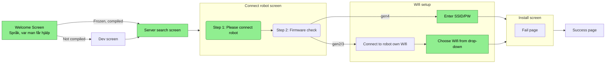

# Vacuula Setup Wizard

Goals for this is to:
1. Look good
2. Unify installation for all supported neatos
3. Work on mac, windows, any resonable linux distro
4. Easy localisation
5. Be as much of "one click install" mantra as possible aka. KISS

Goals are NOT:
1. Server install walk-trough
2. Un-rainbower

## Current TODO:s in random order



- Prettify the connect vacuula svg, removing the WIP banner (robot->out with dustbin + robot<->computer)
- Fix a more direct link in error.firmware.help
- Go trough the TODO:s that are sprinkled as comments in the code
- Add translations (help wanted, what languages do yall speak?)
- Prettify and unify scripts, for example creating another MTP folder for wifi config, vacuula version textfile and for example allowing to drop vacuula extensions/language packs w/e 'n etc.
- Test on osx


## Run it as dev

```bash
uv run vacuula-installer
```

To pass server detection screen without a server (using avahi-utils):
```bash
avahi-publish -a vacuula-server.local <a-random-but-valid-ip>
```
You can also use that if the server mDNS does not reach the robot network (but the robot can connect to the ip)

## Adding a language

1. Copy `src/locales/en.json` to `src/locales/<code>.json` and translate the values.
2. Get svg for flag you want to use from `https://github.com/lipis/flag-icons` and put into `/src/assets/flags`. Use the 3x4 flags!
2. Add one line to `LANGUAGES` in `src/vacuula_installer/constants.py`:
   ```python
   "fr": LanguageMeta(flag_svg=FLAGS_DIR / "fr.svg", native_name="Français"),
   ```
NOTE! If you add or update strings increment strings version in the updated file(s)!!

Higest "strings-version" or english if all are same is the language to translate from. When "catching up"
a language, update its strings-version to the same as the language it caught up to.

NOTE! While locale.json with the higest "Strings-version" is technically the translation to translate from, lets keep it to en.json.


## Placeholders:
- **`src/vacuula_installer/core/installer.py`** — `InstallerLauncher.launch(model_id)`
  A placeholder draft, needs some refactoring but the working principle is there.
  Real scripts go into `_SCRIPTS` (paths per model) and replace the `TODO` with
  an actual (non-blocking) launch, e.g. `QProcess`.
